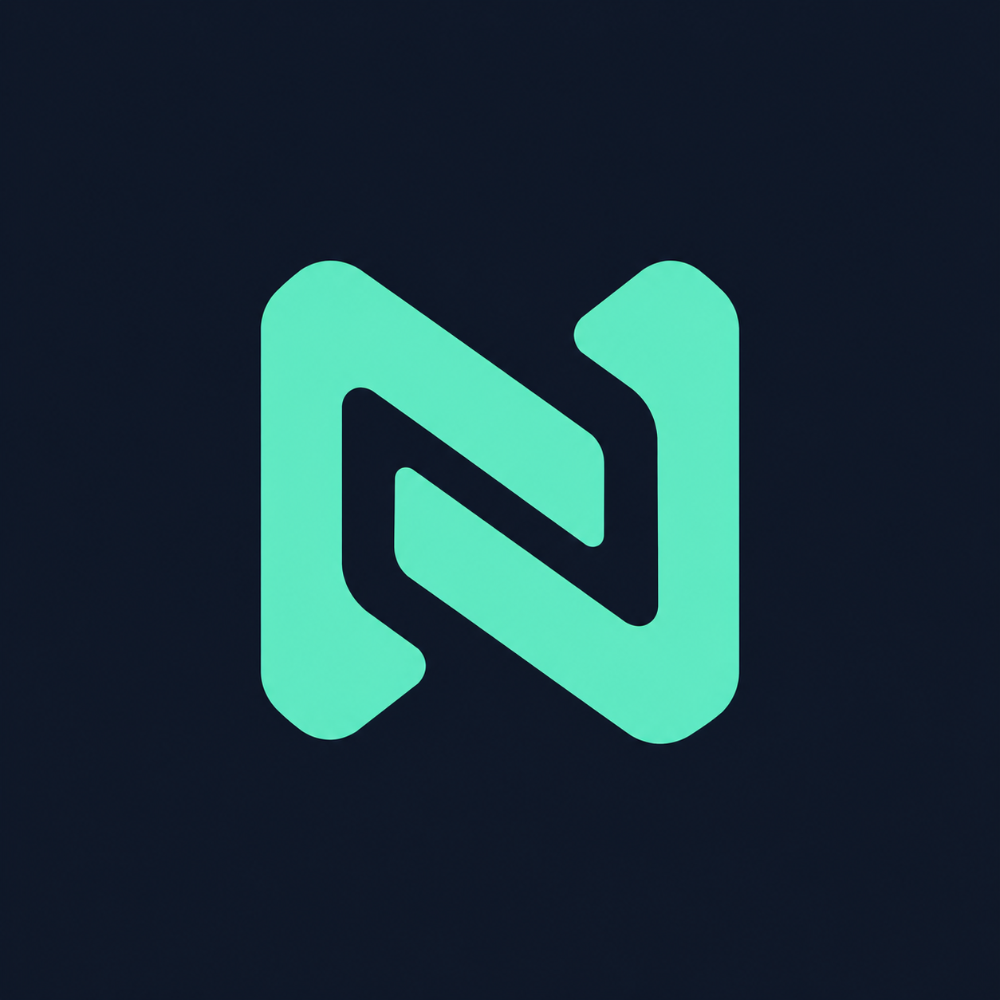

# Nexora

<p align="center"></p>

Mensagens privadas com identidade local, autenticação por chave pública e conexão direta entre dispositivos. Aplicativo Flutter com interface em português, temas claro e escuro e layout adaptado a celular e desktop.

## Telas

- **Primeiro acesso:** criação de apelido e identidade local, sem telefone ou e-mail.
- **Conversas:** busca por apelido ou grupo, lista de contatos identificados pelo apelido recebido, criação/entrada em grupos, exclusão local e validação da chave.
- **Chat:** preparação da conexão, conferência da chave, troca de convite/resposta, mensagens com horário, envio e recebimento de arquivos no app instalado, busca local, bloqueio de contato, limpeza local e desconexão.
- **Configurações:** identidade, aparência, privacidade, histórico, conexão e restauração das preferências.

No desktop, a navegação aparece em uma barra lateral; no celular, na barra inferior. O painel de conexão do chat pode ser recolhido e é fechado automaticamente ao conectar. Os campos e a navegação usam as cores do tema selecionado.

## Iniciar uma conversa

1. Abra o aplicativo e crie um apelido. Uma identidade Ed25519 é gerada no dispositivo; sua chave privada é salva com `flutter_secure_storage`.
2. Em **Configurações → Identidade**, copie sua chave pública. Troque as chaves com seu contato e confira a autenticidade por outro canal.
3. Em **Conversas → Nova conversa**, cole a chave pública Ed25519 Base64 do contato. A lista não exibe a chave nem pede um nome local: antes da primeira conexão, mostra **Aguardando apelido**. Após conectar, recebe o apelido escolhido pelo contato pelo canal autenticado e criptografado.
4. Um participante seleciona **Criar convite** e compartilha o conteúdo. O outro cola esse convite e seleciona **Gerar resposta**. O primeiro cola a resposta e seleciona **Aplicar resposta**.
5. Aguarde **Conectado com criptografia** para enviar mensagens.

Convites expiram em dez minutos. Mantenha os relógios sincronizados. Não é possível conectar usando somente a chave pública: ela identifica o contato, mas não informa seu endereço de rede. A sinalização continua manual.

O serviço usa WebRTC DataChannel. O modo direto permite ao contato descobrir seu IP. STUN não retransmite mensagens nem anonimiza: seus operadores podem observar IP e horários. Os padrões são Cloudflare (`stun:stun.cloudflare.com:3478`), Twilio (`stun:global.stun.twilio.com:3478`), Nextcloud (`stun:stun.nextcloud.com:443`) e Sipgate (`stun:stun.sipgate.net:3478`). A inclusão não garante disponibilidade desses serviços.

### Configuração de rede

Substitua a lista com `--dart-define=NEXORA_STUN_URLS=stun:seu-servidor:3478`; um valor vazio evita consultas STUN externas no modo direto.

Para ocultar o IP do contato, configure um servidor TURN real e ative o modo exclusivo:

```sh
flutter run -d windows --dart-define=NEXORA_RELAY_ONLY=true --dart-define=NEXORA_TURN_URLS=turns:turn.seu-dominio.com:5349?transport=tcp --dart-define=NEXORA_TURN_USERNAME=usuario --dart-define=NEXORA_TURN_CREDENTIAL=credencial-temporaria
```

O domínio é ilustrativo. A configuração privada exige URL, usuário e credencial; usa `iceTransportPolicy: relay`, não consulta a lista STUN e não retorna automaticamente ao modo direto. A sinalização remove candidatos locais e endereços relacionados, e falha se não houver candidato relay. O operador TURN ainda conhece o IP do usuário. Isso não é Tor nem anonimato contra o operador ou análise de tráfego. Uma simulação de múltiplos saltos não protegeria a conexão real e não foi apresentada como recurso de privacidade.

Credenciais de compilação são extraíveis do aplicativo: use credenciais temporárias de teste; produção requer provisionamento autenticado de credenciais de curta duração. Não distribua uma senha permanente compartilhada. A sinalização continua manual e deve ser compartilhada por canal confiável. Redes restritivas podem impedir a conexão.

## Contatos e grupos

Uma chave pública identifica a pessoa, mas não contém apelido nem permite buscar um perfil offline. O apelido é trocado automaticamente depois de estabelecer uma conexão autenticada com essa chave e é salvo para as próximas aberturas. Não é um identificador único: pessoas diferentes podem escolher o mesmo apelido. A conferência da chave continua disponível no painel de conexão.

Para criar um grupo:

1. Adicione e conecte-se individualmente com pelo menos dois contatos, para receber seus apelidos.
2. Em **Conversas → Criar grupo**, informe o nome e selecione os contatos pelos apelidos.
3. O convite do grupo é copiado após a criação. Compartilhe-o com os membros por um canal confiável; para copiá-lo novamente, use o menu do grupo.
4. Cada membro usa **Entrar em grupo** e cola o mesmo convite. A assinatura é verificada, e a chave local precisa estar entre os membros. Confirme a origem por outro canal: a assinatura comprova o autor da chave, não que seu apelido seja exclusivo ou que o grupo seja confiável.
5. No painel de conexão do grupo, selecione um participante e troque convite/resposta de conexão com ele. Repita para cada participante. Cada par precisa realizar essa negociação: um grupo de três pessoas requer três conexões entre pares.
6. O compositor é liberado quando o dispositivo está conectado a todos os outros membros. As mensagens mostram o apelido do autor e são enviadas separadamente, com criptografia, a cada participante conectado. Não há retransmissão por outro membro.

O convite de grupo contém somente identificador, nome, chaves dos membros e assinatura; não inclui IP, SDP nem candidatos ICE. O convite de **conexão** é outro conteúdo, temporário, usado para negociar WebRTC. Mensagens do grupo validam o identificador e a lista de membros, impedindo a mistura com outro grupo. Um convite com membros diferentes não substitui um grupo local com o mesmo identificador.

A composição do grupo é fixa nesta versão; para mudar os membros, crie outro grupo. Todos precisam usar uma versão com suporte a grupos. Arquivos permanecem disponíveis nas conversas individuais. Não há entrega offline nem confirmação de leitura. Se uma conexão falhar durante o envio, alguns membros podem ter recebido a mensagem antes da falha; reenviar pode duplicá-la. O modelo de conexões entre todos os pares aumenta o uso de rede e recursos conforme o grupo cresce.

## Configurações disponíveis

| Área | Configuração | Efeito |
| --- | --- | --- |
| Identidade | Apelido | Edita o nome de até 32 caracteres, compartilhado com contatos ao conectar. Alterações são reenviadas na próxima conexão. |
| Identidade | Chave pública | Permite visualizar e copiar a identidade compartilhável. |
| Aparência | Tema | Alterna entre claro e escuro. |
| Aparência | Cor de destaque | Menta, azul ou violeta no fundo, cartões, campos, controles e navegação, tanto no tema claro quanto no escuro. |
| Aparência | Texto | Escala de 12 a 22; combinada com a acessibilidade do sistema. |
| Aparência | Animações | Controla transições de tela e rolagem automática do chat. |
| Histórico | Armazenamento | Sem limite de quantidade de mensagens ou de tamanho total imposto pelo app. O espaço e as restrições do armazenamento seguro da plataforma continuam se aplicando. |
| Histórico | Limpeza automática local | Remove mensagens da memória e da cópia salva ao fechar a conversa; após 1, 5 ou 30 minutos, 1 hora, 1, 7, 30, 90 ou 180 dias, ou 1 ano; ou permite manter o histórico sem exclusão automática. A verificação ocorre a cada 5 segundos, a partir da chegada local. |
| Conexão | Tempo de preparação | Limita a coleta de dados ICE a 10, 20, 30, 45 ou 60 segundos, aplicado ao abrir a próxima conversa. |
| Preferências | Restaurar | Restaura os padrões após confirmação e mantém a identidade. |

As preferências são persistidas com `SharedPreferencesAsync` do pacote `shared_preferences: 2.5.6`, com leituras e gravações assíncronas. Identidade, chave privada, contatos e histórico usam `flutter_secure_storage: ^11.2.0`. Criptografia é obrigatória; não existe opção para enviar texto sem criptografia. TURN pode retransmitir o canal criptografado quando configurado na compilação. STUN é usado apenas para descoberta de endereços.

Minimizar o aplicativo preserva a conexão, o histórico, o rascunho e o convite. Sair da tela da conversa encerra a conexão. No padrão de limpeza ao fechar, o histórico salvo também é removido; com retenção por prazo, mensagens ainda válidas podem ser restauradas ao reabrir a conversa. A opção de manter o histórico desativa a exclusão por tempo, sem corte por quantidade de mensagens ou tamanho total.

## Enviar e receber arquivos

1. Conecte os dois participantes e toque no clipe ao lado do campo de mensagem.
2. Leia a recomendação de privacidade e selecione um arquivo. Recomendamos enviar apenas `.safe` preparados por uma ferramenta confiável; renomear a extensão não protege o conteúdo. Outros formatos também são aceitos.
3. O destinatário escolhe uma pasta para aceitar o recebimento. O envio começa após essa confirmação.
4. Aguarde a mensagem de conclusão. O arquivo recebido usa o nome `nexora-<identificador>-<nome sanitizado>`; o caminho aparece na confirmação.

O app não impõe limite ao tamanho total. A transferência lê a origem por fluxo e grava o destino em disco, sem reunir o arquivo completo na memória. Espaço livre, permissões da pasta, sistema de arquivos, disponibilidade da origem e conexão continuam limitando o envio. Pastas protegidas ou não acessíveis pelo seletor nativo podem impedir o recebimento.

As partes passam pelo mesmo canal criptografado das mensagens. O arquivo salvo na pasta escolhida não recebe uma camada adicional de criptografia do Nexora: sua proteção em repouso depende do próprio arquivo e do dispositivo. Arquivos e pacotes de controle não entram no histórico de mensagens e não são apagados pela limpeza automática do chat.

### Desempenho e interrupções

- Partes de até 12 KiB, com agrupamento de leituras pequenas para evitar pacotes desnecessários.
- Negociação de lotes de até oito partes pendentes (96 KiB de conteúdo bruto), com confirmação de cada parte após a gravação. Um destinatário anterior sem suporte a lotes continua recebendo uma parte por vez.
- Recebimento serializado para preservar a ordem das gravações e limitar a fila. Confirmações são processadas separadamente, permitindo transferências nos dois sentidos.
- Até cinco minutos para escolher a pasta; depois, até 30 segundos para confirmar cada parte. O recebimento parado é descartado após cinco minutos de inatividade enquanto o app estiver em execução.
- Finalização somente após conferir o tamanho e descarregar as gravações em disco. Isso confirma a conclusão do protocolo, sem garantir persistência diante de falha física ou queda de energia.
- Recusa, erro de tamanho, desconexão ou fechamento da conversa interrompem a transferência e tentam remover o arquivo parcial. Cancelar enquanto o seletor está aberto impede que o recebimento seja iniciado depois. Encerramento forçado do processo pode deixar um parcial na pasta.

Há no máximo um envio e um recebimento ativos por conversa. Transferências interrompidas precisam ser iniciadas novamente; não há retomada automática. O envio de arquivos está disponível no aplicativo instalado; a versão web apresenta uma mensagem informando essa limitação. Os seletores e as permissões precisam de validação nas plataformas de destino.

## Execução em segundo plano

| Plataforma | Comportamento |
| --- | --- |
| Android | Serviço nativo em primeiro plano, iniciado ao criar ou aceitar um convite, com notificação de conexão e bloqueio parcial de suspensão da CPU. Continua durante a negociação e o chat ao minimizar o app. |
| Windows, macOS e Linux | Minimizar a janela mantém o processo e a conexão enquanto o sistema permitir. Fechar o aplicativo encerra a sessão. |
| Web | Trocar de aba não desconecta pelo código do aplicativo. O navegador pode limitar ou suspender abas em segundo plano. |
| iOS | O aplicativo preserva a sessão ao minimizar, mas o sistema pode suspender a execução e interromper a conexão; não há garantia de mensageria P2P contínua em segundo plano. |

No Android, a notificação não contém mensagens, nomes ou chaves. Ao tocar nela, a tela do aplicativo é reaberta. A permissão de notificações é solicitada nas versões que a exigem; sua recusa pode ocultar a notificação da área usual, sem conceder execução irrestrita ao aplicativo. O serviço utiliza o tipo `remoteMessaging` e é encerrado ao desconectar, falhar a conexão, bloquear o contato, sair da tela da conversa ou remover o aplicativo da lista de tarefas. Não é iniciado no boot e não tenta recuperar uma sessão WebRTC após o encerramento do processo.

O serviço utiliza CPU enquanto uma sessão está ativa e pode aumentar o consumo de bateria. Restrições do fabricante, economia de energia, encerramento forçado, suspensão do computador e perda de rede ainda podem interromper a comunicação. O aplicativo não solicita exclusão automática das otimizações de bateria nem inclui serviços intermediários para contornar essas restrições.

Referências: [serviços em primeiro plano Android](https://developer.android.com/develop/background-work/services/fgs/service-types), [permissão de notificações Android](https://developer.android.com/develop/ui/views/notifications/notification-permission) e [execução em segundo plano no iOS](https://developer.apple.com/documentation/uikit/preparing-your-ui-to-run-in-the-background).

## Recursos gerais e de segurança

- **Bloquear contato:** no menu do chat (no grupo, bloqueia o participante selecionado e encerra a sessão local), encerra a conexão, limpa o histórico local e impede envio, negociação e apresentação de novas mensagens daquela chave neste dispositivo. A lista fica no armazenamento seguro. Para desbloquear, use **Configurações → Contatos bloqueados**. O bloqueio identifica uma chave: não impede alguém de criar outra identidade.
- **Buscar mensagens:** a lupa do chat pesquisa somente as mensagens locais carregadas, sem enviar consultas à rede.
- **Gerenciar conversas:** o menu permite excluir a conversa local, inclusive o histórico protegido. Grupos também podem ser renomeados localmente e ter seu convite copiado. O apelido de um contato individual é informado pelo próprio contato. A exclusão não remove cópias do destinatário e não desfaz um bloqueio existente.

## Responsividade e desempenho

A lista de conversas e o histórico utilizam construção de itens sob demanda. O chat limita a largura das mensagens em monitores maiores e mantém o painel de conexão rolável, preservando espaço para o compositor em janelas menores. Estados vazios podem rolar quando o teclado ou o texto ampliado reduz a área disponível. Preferências respeitam o tamanho de texto e a redução de movimento do sistema.

A limpeza periódica evita reconstruir a tela quando nenhuma mensagem expirou. A manutenção dos horários de chegada usa um conjunto de mensagens retidas para evitar buscas repetidas. O processamento de entrada tem fila limitada a 32 mensagens, com rejeição antecipada de pacotes excessivos, e preserva a ordem de verificação. Sob sobrecarga, mensagens de texto podem ser descartadas; elas não têm confirmação de entrega. Arquivos usam confirmações próprias e lotes limitados, mas continuam dependendo da capacidade do canal compartilhado. A chave AES da sessão é preparada uma vez por serviço e reutilizada nas operações; cada mensagem continua usando um novo nonce. Uma fila reutilizável serializa as operações de cada serviço e continua funcionando após falhas. Identidade, perfil e conversas compartilham o `LocalDataService` e uma única fila de armazenamento seguro, evitando perda de alterações concorrentes.

## Armazenamento

| Dados | API/pacote |
| --- | --- |
| Aparência, privacidade, retenção e opções de conexão | `SharedPreferencesAsync` — `shared_preferences: 2.5.6` |
| Apelido, identidade e chave privada | Nativo: `flutter_secure_storage: ^11.2.0`; web: memória da sessão |
| Contatos, metadados e mensagens de conversas | Nativo: `flutter_secure_storage: ^11.2.0`; web: memória da sessão |

O aplicativo aceita somente os formatos atuais: configurações `v3`, conta `v2` e conversas `v2`. Não há importação, conversão ou migração de dados e contas de versões anteriores. As preferências usam exclusivamente `SharedPreferencesAsync`. O antigo campo de limite de mensagens é ignorado ao ler configurações v3 e deixa de ser gravado; as demais preferências são preservadas.

Instalações com contas anteriores precisam criar uma nova identidade e compartilhar a nova chave pública. Os registros antigos não são lidos nem apagados automaticamente; ficam fora do armazenamento utilizado por esta versão. Nas plataformas nativas, a restauração entre aberturas funciona somente para contas criadas no formato atual. Na web, conta, contatos e histórico ficam somente em memória e desaparecem ao recarregar ou encerrar a sessão da página; as preferências continuam persistidas. Chaves ausentes ou incompatíveis geram erro; não são reparadas nem substituídas silenciosamente.

As gravações de conversas são serializadas para impedir que uma gravação pendente restaure mensagens após uma limpeza. A lista de contatos é restaurada depois da identidade. O histórico é serializado e gravado integralmente: históricos grandes podem aumentar o consumo de memória e o tempo de gravação. Falhas de armazenamento são informadas, sem corte silencioso das mensagens. Mensagens não utilizam SharedPreferences e convites, rascunhos e chaves temporárias da conexão não são persistidos.

No modo padrão, o histórico é salvo de forma protegida enquanto a conversa está aberta e removido ao fechá-la. Depois de um encerramento inesperado, esse histórico também é descartado na próxima inicialização. Com retenção por prazo, a restauração mantém apenas mensagens ainda válidas. Na opção de manter o histórico, a restauração preserva todas as mensagens salvas. A limpeza depende da execução do aplicativo; nenhum processo continua removendo dados enquanto ele está encerrado. O sistema pode interromper operações de armazenamento em andamento ao finalizar o processo.

### Dados de rede não persistidos

O Nexora não grava IPs dos participantes, endereços de rede, SDP ou candidatos ICE no armazenamento local de contas, contatos ou conversas. Esses dados são usados transitoriamente pelo WebRTC durante a sessão. São persistidos identidade e chaves, apelidos recebidos, membros e metadados das conversas, histórico e preferências do aplicativo. Quadros de perfil e controle não entram no histórico.

Essa regra trata dos metadados de conexão: um endereço que alguém escrever em uma mensagem faz parte do conteúdo escolhido para o histórico. Convites de conexão copiados ficam sujeitos ao histórico da área de transferência e ao canal externo usado para compartilhá-los; o Nexora não controla esses serviços. Não persistir IPs também não impede que os participantes de uma conexão direta descubram os endereços pela rede.

## Segurança e limites

- Negociação SDP/ICE e chave temporária assinadas com **Ed25519**, verificadas contra a chave pública informada.
- Verificação de destinatário, versão, sessão e validade; a resposta também autentica o hash do convite original.
- **X25519** temporário por conexão e **HKDF-SHA256** vinculada à sessão e às duas identidades.
- Mensagens com **AES-256-GCM**, metadados autenticados e transporte **WebRTC DTLS**.
- Rejeição de mensagens adulteradas, repetidas, refletidas ou pertencentes a outra sessão/remetente; processamento e envio sequenciais.
- Nas plataformas nativas, lista de conversas, apelidos de contatos e mensagens persistidos com armazenamento seguro, separados pela identidade local. Na web, esses dados ficam somente em memória. A expiração também se aplica à cópia salva; dados expirados são descartados ao restaurar o aplicativo ou reabrir o chat.
- Backup Android desativado e permissões de rede configuradas no macOS.

Este protocolo ainda precisa de auditoria independente antes de uso com dados sensíveis. Não existe garantia de segurança total. Dispositivos comprometidos, capturas de tela e cópias do destinatário podem expor mensagens. A limpeza local não apaga cópias remotas nem garante apagamento físico da memória.

Os convites são assinados, mas não criptografados: contêm metadados SDP/ICE, inclusive informações de rede. O aplicativo não mostra endereços IP dos participantes: o campo de convite/resposta fica oculto e erros técnicos não são exibidos diretamente. A chave pública continua visível para conferir a identidade. Essa ocultação se aplica à interface: os convites copiados ainda transportam os dados necessários à conexão, e o outro dispositivo pode descobrir o IP por ferramentas de rede. Uma conexão P2P direta não fornece anonimato de rede; para ocultar o IP do contato, use o modo TURN exclusivo descrito em Configuração de rede; o modo direto continua expondo o IP. O modelo de proteção do armazenamento seguro varia por plataforma, principalmente na web.

Não há sincronização, recuperação de identidade ou entrega offline. Arquivos exigem os participantes conectados simultaneamente. Convites antigos, anteriores ao protocolo assinado, não são aceitos.

## Executar

Requer Flutter com Dart compatível com `sdk: ^3.13.5` e as ferramentas nativas da plataforma desejada.

```sh
flutter pub get
flutter run -d windows
# Outras opções, no sistema compatível:
flutter devices
flutter run -d <id-do-dispositivo-android>
flutter run -d chrome
flutter run -d <id-do-dispositivo-ios>
flutter run -d macos
flutter run -d linux
```

Android requer um dispositivo ou emulador. Builds de iOS/macOS exigem macOS e Xcode; Linux requer sua toolchain nativa. Os ícones são gerados para todos os alvos sem exigir a compilação de cada aplicativo.

## Ícones em todas as plataformas

O ícone principal está em [`assets/icon.png`](assets/icon.png). A configuração solicitada está no `pubspec.yaml`:

```yaml
dev_dependencies:
  flutter_launcher_icons: ^0.14.3
```

O intervalo `^0.14.3` permite versões compatíveis; o lockfile atual resolve `0.14.4`. Para regenerar todos os ícones a partir da raiz:

```sh
dart run tool/generate_icons.dart
```

O script executa `flutter_launcher_icons` e sincroniza o ícone do Linux:

| Plataforma | Aplicação |
| --- | --- |
| Android | Ícones por densidade e variante adaptativa. |
| iOS | Catálogo AppIcon, com remoção de transparência. |
| Web | Favicon, ícones PWA, variantes maskable e cores do manifesto. |
| Windows | `windows/runner/resources/app_icon.ico`, com 256 px. |
| macOS | Catálogo AppIcon do Runner. |
| Linux | Ícone da janela GTK, PNG de 512 px e arquivo `.desktop`. |

O pacote não oferece geração Linux nativa nessa configuração; o script copia a saída web de 512 px para `linux/runner/resources/app_icon.png`. O CMake inclui o ícone e `com.moon.nexora.desktop` no diretório `share` do bundle. Pacotes Linux devem instalar esses arquivos nas pastas de ícones e aplicativos do sistema, mantendo o executável `nexora` disponível no PATH.

Detalhes de criação da marca em [`docs/icon-design.md`](docs/icon-design.md). Após reinstalar uma versão com novo ícone, o launcher do sistema pode precisar atualizar seu cache.

## Verificação

```sh
flutter analyze
flutter test
```

- `test/message_security_test.dart`: identidades distintas, nonces únicos em envios simultâneos, rejeição de replay e encerramento após adulteração do MAC.
- `test/network_security_test.dart`: exigência de credenciais TURN, exclusão de STUN no modo relay, remoção de endereços locais do SDP, falha sem candidato relay e rejeição de endpoints inválidos.

A validação real de WebRTC exige dois dispositivos nas plataformas e redes desejadas, incluindo testes com a tela apagada e o aplicativo minimizado. O serviço Android também precisa ser validado em dispositivo real; testes Dart não compilam nem executam seu código Kotlin. Testes de layout e criptografia não substituem essa verificação nem uma auditoria de segurança.

## Estrutura

```text
lib/src/app.dart                       Tema e navegação responsiva
lib/src/models/                       Modelos e preferências
lib/src/services/local_data_service.dart Identidade, contatos e histórico seguro
lib/src/services/file_transfer_io.dart Fluxo de arquivos, confirmações e gravação serializada
lib/src/services/conversation_connection_service.dart Conexões por participante e envio ao grupo
lib/src/services/group_invitation_service.dart Convites assinados sem dados de rede
lib/src/services/                     Conexão, mensagens e preferências
lib/src/utils/serial_task_queue.dart   Serialização assíncrona compartilhada
lib/src/views/                        Entrada, conversas, chat e configurações
lib/src/views/widgets/                 Tema, marca, lista e confirmação reutilizável
assets/icon.png                       Ícone original
tool/generate_icons.dart              Geração multiplataforma
test/                                 Testes de segurança de mensagens e configuração de rede
```

Referências: [cryptography](https://pub.dev/documentation/cryptography/latest/) e [flutter_launcher_icons 0.14.3](https://pub.dev/packages/flutter_launcher_icons/versions/0.14.3).

## Reforços de segurança desta revisão

- **SEC-01 — Exposição de IP:** modo direto informa sua limitação na interface. O modo TURN exclusivo usa `iceTransportPolicy: relay`, exclui STUN da configuração e remove candidatos locais e endereços relacionados do SDP exportado. Sem candidato relay, a sinalização falha, sem retorno automático à conexão direta. Exige servidor TURN real e credenciais válidas. O operador TURN vê o IP; não há integração Tor nem simulação com promessa de anonimato.
- **SEC-05 — Infraestrutura externa:** os padrões STUN são Cloudflare, Twilio, Nextcloud e Sipgate, conforme a lista em Configuração de rede. A lista pode ser substituída por infraestrutura própria com `NEXORA_STUN_URLS` ou desativada com valor vazio. Endpoints têm esquema e porta validados. Credenciais TURN vazias ou compostas somente de espaços são rejeitadas no modo exclusivo. A presença dos quatro servidores não garante disponibilidade nem anonimato.
- Mensagens usam envelope v2, chaves direcionais HKDF e nonce de 96 bits derivado do contador monotônico. Direções diferentes têm chaves diferentes. O contador tem limite explícito seguro também para web; uma nova sessão gera chaves efêmeras novas. Ambos os participantes precisam atualizar.
- **SEC-02 — Protocolo criptográfico:** identidades e sessão permanecem vinculadas à derivação de chaves; sequência, remetente, sessão e metadados são autenticados. O serviço de mensagens rejeita sessão vazia, identidades vazias ou iguais, impedindo que as duas direções usem a mesma chave. Repetições são rejeitadas. Falha AES-GCM encerra o canal sem liberar o conteúdo.
- Na web, conta, contatos e histórico novos ficam somente em memória e desaparecem ao recarregar. Preferências visuais continuam persistidas. Dados web de versões anteriores não são apagados automaticamente: limpe os dados do site no navegador para removê-los.
- **SEC-03 — Armazenamento e retenção:** nas plataformas nativas, permanece o armazenamento seguro do sistema. As gravações são serializadas e a restauração verifica a correspondência entre chave privada e identidade pública. Backup Android já está desativado. Não há garantia de apagamento físico, proteção em dispositivo comprometido ou eliminação de cópias antigas/backups. Dados legados continuam sujeitos à limpeza manual; esta revisão não migra identidades antigas.

Testes de regressão em `test/message_security_test.dart` verificam nonces únicos em envios simultâneos, rejeição de replay, encerramento após MAC adulterado e rejeição de identidades iguais (que reutilizariam a chave direcional). `test/network_security_test.dart` verifica a política TURN exclusiva e a remoção de endereços locais da sinalização.

Validação executada nesta revisão: `flutter test` com **4 testes aprovados** e `flutter analyze` **sem problemas**. Para repetir:

```sh
flutter test
flutter analyze
```

Validação de plataforma e rede pendente: dois dispositivos, TURN indisponível, inspeção dos convites e captura de rede para confirmar ausência de conexões diretas no modo privado, reinício durante gravações e verificação de retenção no armazenamento de cada sistema. Testes unitários não equivalem a auditoria criptográfica.
