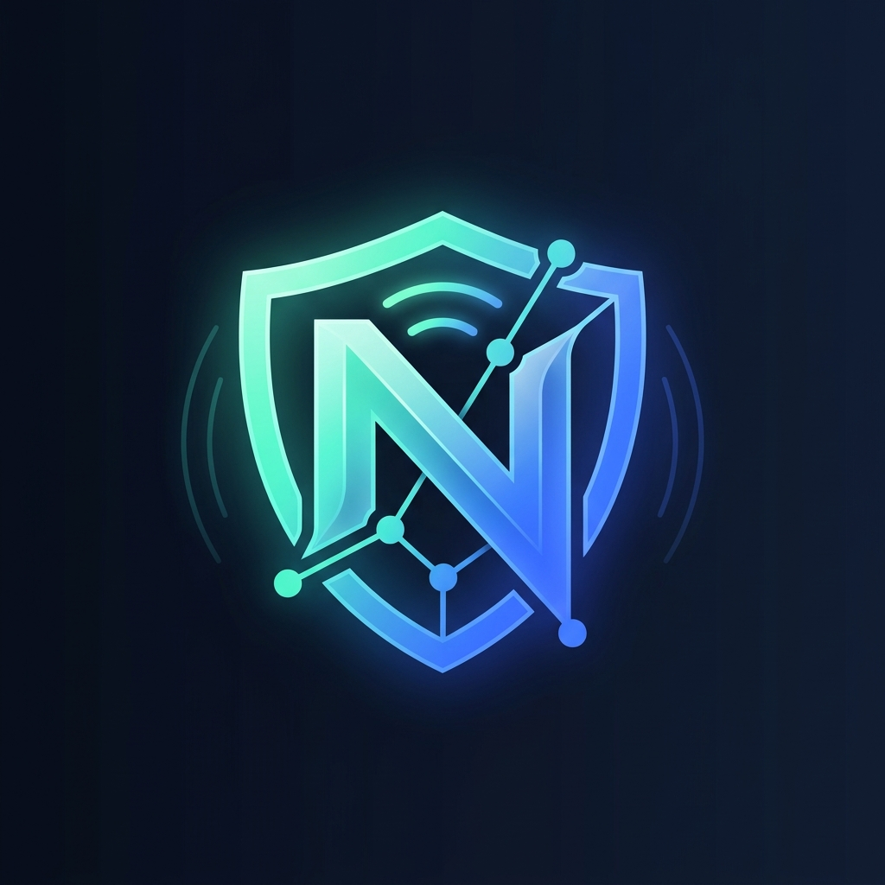
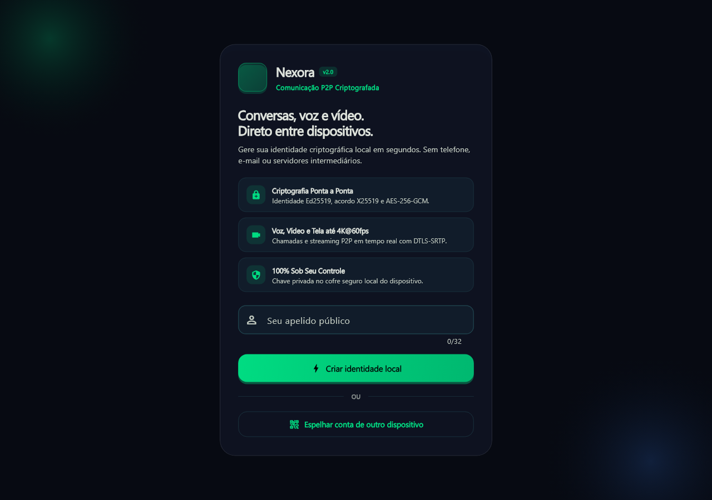
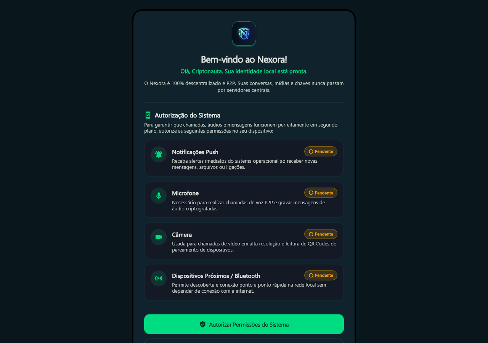
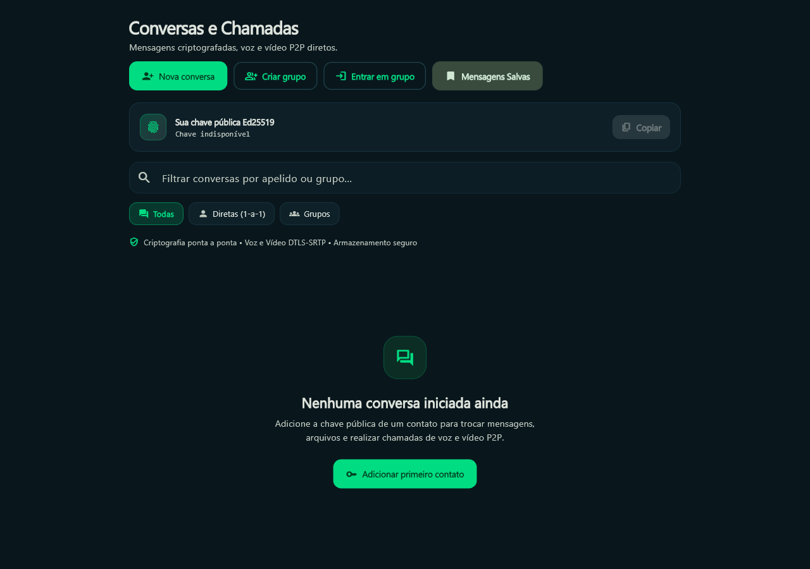
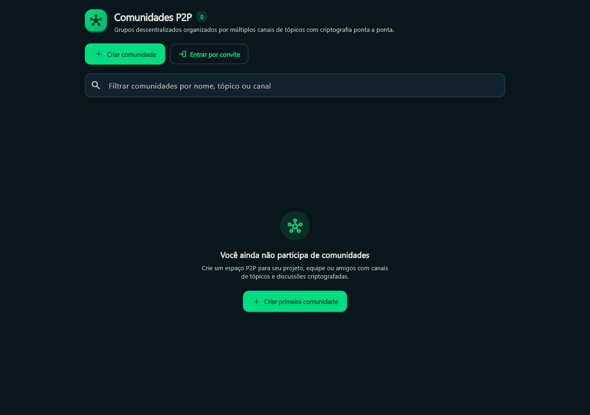
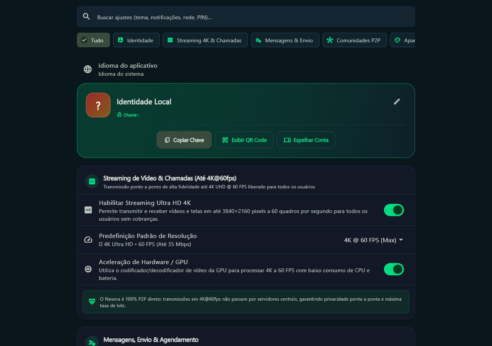
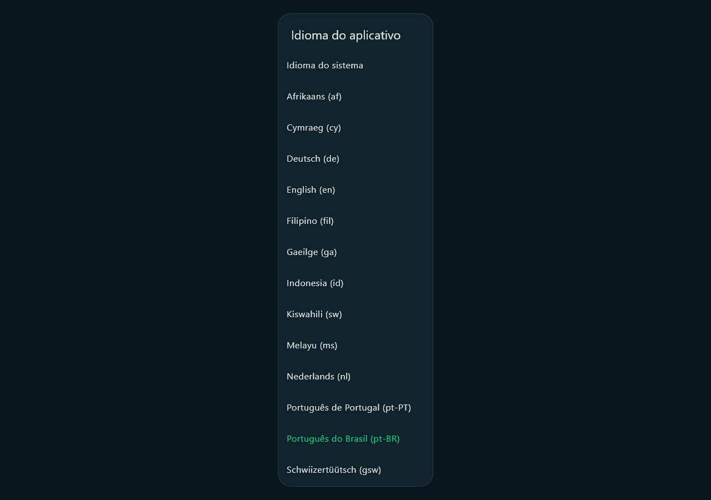
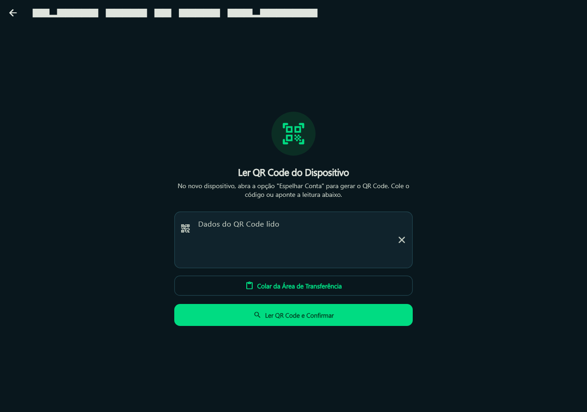

<p align="center"></p>

# Nexora

O Nexora é um aplicativo Flutter de comunicação entre dispositivos. Ele oferece conversas individuais, grupos e comunidades, mensagens de voz, transferência de arquivos, chamadas de áudio e vídeo e compartilhamento de tela. A identidade é criada no aparelho e as sessões são estabelecidas via WebRTC.

A troca de convites é manual. O aplicativo usa STUN por padrão para ajudar a estabelecer conexões diretas e pode usar TURN para retransmitir tráfego quando configurado. Identidade, preferências e histórico são gerenciados localmente, sem cadastro por telefone ou e-mail.

## Índice

- [Capturas de tela](#capturas-de-tela)
- [Primeiros passos](#primeiros-passos)
- [Mensagens, grupos e comunidades](#mensagens-grupos-e-comunidades)
- [Chamadas e arquivos](#chamadas-e-arquivos)
- [Configurações e dados locais](#configurações-e-dados-locais)
- [Segurança e privacidade](#segurança-e-privacidade)
- [Configuração de rede](#configuração-de-rede)
- [Instalação e desenvolvimento](#instalação-e-desenvolvimento)
- [Compilação e distribuição](#compilação-e-distribuição)
- [Estrutura do código](#estrutura-do-código)
- [Solução de problemas](#solução-de-problemas)

## Capturas de tela

Telas renderizadas a partir da interface atual do Nexora, em português e com o tema escuro. As capturas mostram uma instalação de exemplo.

| Tela | Prévia |
| --- | --- |
| Criação de identidade | [](docs/screenshots/01-identidade.png) |
| Permissões | [](docs/screenshots/02-permissoes.png) |
| Conversas | [](docs/screenshots/03-conversas.png) |
| Comunidades | [](docs/screenshots/04-comunidades.png) |
| Configurações | [](docs/screenshots/05-configuracoes.png) |
| Seleção de idioma | [](docs/screenshots/06-idioma.png) |
| Espelhamento de conta | [](docs/screenshots/07-espelhamento.png) |

## Primeiros passos

1. Abra o Nexora e crie sua identidade com um apelido. Conceda as permissões necessárias aos recursos que pretende usar, como microfone, câmera e notificações.
2. Abra **Configurações** e copie sua chave pública. Compartilhe essa chave com quem vai conversar com você e peça a chave pública da outra pessoa.
3. Em **Nova conversa P2P**, informe a chave pública do contato. Ela identifica o contato, enquanto o convite de conexão carrega os dados necessários para abrir uma sessão.
4. No **Assistente de conexão P2P**, um dos participantes cria um convite e o envia ao outro por um canal externo.
5. O destinatário cola o convite no assistente, gera uma resposta e devolve o código. Quem iniciou a sessão cola e aplica essa resposta.
6. Aguarde o indicador de conexão antes de enviar mensagens ou iniciar uma chamada. Se os códigos expirarem, gere um novo convite e repita a troca.

Convites de sessão têm validade de aproximadamente dez minutos. Mantenha os relógios dos aparelhos sincronizados durante o pareamento. Para confirmar a identidade do contato, compare os números de segurança por um canal independente ou presencialmente.

## Mensagens, grupos e comunidades

| Recurso | Como usar |
| --- | --- |
| Conversas e abas | Abra uma conversa pela tela inicial. A barra integrada permite alternar entre o início e as conversas abertas e sinaliza mensagens não lidas e chamadas ativas. |
| Organização | Use a busca local e os filtros da tela inicial. O menu da conversa oferece ações como fixar e silenciar. |
| Ações em mensagens | Abra o menu do balão para responder com citação, copiar, marcar com estrela ou fixar. Use as reações para responder com emoji. |
| Mensagens de voz | Use o microfone do compositor para gravar. O destinatário pode reproduzir o áudio no balão da mensagem. |
| Visualização única | Ative a opção no compositor da conversa individual. A interface exibe a contagem regressiva após a abertura. |
| Mensagens efêmeras | Configure a duração pelo menu da conversa. A expiração é aplicada pelo aplicativo ao histórico que ele gerencia. |
| Agendamento | Escolha a data e o horário no compositor. Consulte, cancele ou dispare os agendamentos pela interface. O processamento é local e o envio depende da execução do aplicativo e da conectividade da conversa. |
| Mensagens salvas | Use o cofre pessoal para guardar conteúdo local sem abrir uma sessão com outro aparelho. |
| Notas do contato | Registre anotações privadas nas opções da conversa individual. Elas ficam neste aparelho. |

### Grupos e comunidades

- Para criar um grupo, abra **Criar grupo em malha P2P**, dê um nome ao grupo e selecione os participantes. Compartilhe o convite assinado. Os convidados usam **Entrar em grupo** para importar o código.
- Na área **Comunidades**, crie uma comunidade ou use **Entrar em comunidade ou grupo P2P** para importar um convite. A comunidade organiza conversas em canais e oferece informações, descrição e regras.
- Na barra de canais, selecione um tópico ou abra a opção de criar um canal. As opções da comunidade incluem editar detalhes, convidar membros, silenciar e gerenciar canais e históricos locais.
- Use **Criar enquete** no compositor para publicar uma pergunta com opções de voto. A atualização para os outros membros depende das conexões entre os pares.

O convite importa os dados do grupo ou da comunidade. A comunicação ainda depende das sessões WebRTC entre os participantes. Em grupos, cada conexão consome recursos do aparelho e da rede. A disponibilidade dos pares afeta quem recebe conteúdo em tempo real.

## Chamadas e arquivos

### Voz, vídeo e compartilhamento de tela

1. Abra uma conversa com pelo menos um par conectado e selecione o botão de telefone, câmera ou tela no cabeçalho, conforme disponível.
2. Autorize o acesso aos dispositivos de mídia ou à captura de tela quando o sistema pedir. No desktop, selecione a tela ou janela quando o seletor estiver disponível.
3. Use os controles do painel para silenciar o microfone, ligar ou desligar a câmera, iniciar ou interromper o compartilhamento e encerrar a chamada. O painel também pode ser minimizado para voltar ao chat.
4. Ajuste as preferências de resolução em **Configurações**. A resolução e a fluidez efetivas dependem da captura, do hardware, do suporte do WebRTC e da rede.

A disponibilidade de captura e roteamento de áudio varia conforme a plataforma e as permissões. No Android, o projeto inclui um serviço nativo em primeiro plano para apoiar a continuidade das conexões. O sistema operacional pode interromper a execução em segundo plano.

### Arquivos

Use **Enviar arquivo P2P**, escolha o arquivo e confirme se a configuração de confirmação estiver ativa. O receptor deve acompanhar a solicitação e escolher o destino quando solicitado. Mantenha os pares conectados até a conclusão. Em conversas de grupo, o envio usa os pares disponíveis.

A transferência lê o arquivo em blocos de 12 KiB e acompanha a confirmação das partes. O espaço em disco, o estado da sessão e os tempos limite do protocolo influenciam o resultado. Em caso de interrupção, restabeleça a conexão e refaça o envio.

## Configurações e dados locais

- **Perfil e aparência** — edite o apelido, ajuste tema, paleta, modo escuro ou AMOLED, papel de parede, estilo das bolhas e densidade da interface.
- **Conversas** — configure o comportamento da tecla Enter, confirmação de arquivos e recibos de leitura.
- **Privacidade** — ajuste o desfoque visual, o painel de inspeção criptográfica e a lista de contatos bloqueados.
- **Notificações** — controle os alertas e a exibição de prévias. Os avisos são disparados a partir de eventos recebidos ou processados pelo aplicativo. A entrega depende da sessão e da execução permitida pelo sistema.
- **Armazenamento** — a interface permite limpar históricos locais e arquivos temporários. Arquivos já salvos em outro local são gerenciados pelo sistema de arquivos.

### Usar a identidade em outro aparelho

1. No aparelho novo, abra **Receber Conta por QR Code**, na tela de entrada ou nas configurações.
2. No aparelho com a identidade original, abra **Espelhar Conta em Outro Dispositivo**. Importe o código apresentado pelo receptor e confira o nome do aparelho antes de confirmar.
3. Transfira o código de resposta ao receptor pelo fluxo exibido e conclua a importação. Faça a troca com um aparelho sob seu controle, pois o fluxo transfere material da identidade privada.

O espelhamento permite usar a mesma identidade no segundo aparelho. Histórico e preferências são gerenciados localmente em cada instalação.

## Segurança e privacidade

| Camada | Implementação |
| --- | --- |
| Identidade | Par Ed25519 criado localmente. A chave pública em Base64 pode ser compartilhada para identificar o contato. |
| Sinalização | Convites e respostas de sessão assinados com Ed25519. A validação vincula a resposta ao convite correspondente e verifica a validade temporal. |
| Chaves de sessão | Acordo efêmero X25519 e derivação HKDF-SHA256 para chaves direcionais. |
| Dados da conversa | Cifragem autenticada AES-256-GCM na camada de mensagens. O protocolo usa contadores e dados associados autenticados. |
| Mídia ao vivo | Áudio, vídeo e tela usam a proteção de transporte DTLS-SRTP do WebRTC. |
| Persistência | O serviço local usa FlutterSecureStorage para a identidade e os dados que gerencia. As preferências também usam SharedPreferences. |
| Espelhamento | X25519, HKDF-SHA256 e AES-256-GCM protegem o material transferido durante a importação da identidade. |

Use **Verificação de segurança** no menu da conversa individual para comparar os 60 dígitos ou o QR de verificação. Confirme o resultado após comparar com o contato. Uma assinatura válida confirma a posse da chave correspondente. A comparação por um canal confiável liga essa chave à pessoa esperada.

Visualização única, expiração e limpeza local controlam o conteúdo dentro do aplicativo. Um participante ainda pode copiar ou capturar informações já exibidas. Conexões diretas podem expor endereços de rede ao outro par. O modo TURN exclusivo restringe os candidatos compartilhados aos de retransmissão, e a infraestrutura TURN ainda recebe metadados necessários para operar.

## Configuração de rede

A configuração é lida de definições de compilação do Dart. Use as mesmas opções em `flutter run` ou no comando `flutter build` do alvo.

| Definição | Valor e efeito |
| --- | --- |
| `NEXORA_STUN_URLS` | Lista separada por vírgulas com endereços `stun:host:porta`. O padrão usa serviços públicos da Cloudflare, Twilio, Nextcloud e Sipgate. Um valor vazio desativa a lista STUN. |
| `NEXORA_TURN_URLS` | Lista separada por vírgulas com endereços `turn:` ou `turns:`. Aceita `?transport=udp` ou `?transport=tcp`. Por padrão fica vazia. |
| `NEXORA_TURN_USERNAME` | Usuário da infraestrutura TURN. |
| `NEXORA_TURN_CREDENTIAL` | Credencial da infraestrutura TURN. |
| `NEXORA_RELAY_ONLY` | `false` por padrão. Com `true`, exige TURN com usuário e credencial e restringe a negociação aos candidatos de retransmissão. |

STUN ajuda a descobrir endereços durante a negociação ICE. TURN encaminha o tráfego por um relay. Com TURN configurado e a política padrão, o WebRTC pode considerar candidatos diretos e de relay. Com TURN exclusivo, a geração de sinalização falha se nenhum candidato de relay estiver disponível.

```powershell
flutter run -d windows '--dart-define=NEXORA_STUN_URLS=stun:stun.example.org:3478'
flutter run -d windows '--dart-define=NEXORA_RELAY_ONLY=true' '--dart-define=NEXORA_TURN_URLS=turns:turn.example.org:5349?transport=tcp' '--dart-define=NEXORA_TURN_USERNAME=usuario' '--dart-define=NEXORA_TURN_CREDENTIAL=credencial-temporaria'
```

Substitua os exemplos pelos valores da sua infraestrutura. Definições de compilação podem ser recuperadas do binário distribuído. Evite publicar builds com credenciais TURN permanentes.

## Instalação e desenvolvimento

### Instalação por pacote

| Plataforma | Artefato previsto no workflow | Como usar |
| --- | --- | --- |
| Android | `nexora.apk` | Abra o APK no aparelho e autorize a instalação pela origem usada, se solicitado. |
| Windows | `nexora-Setup.exe` | Execute o instalador e abra o Nexora pelo menu Iniciar. |
| macOS | `nexora.dmg` | Monte a imagem e mova o aplicativo para Aplicativos. A abertura depende dos controles de segurança do sistema. |
| Linux | `nexora.deb` | Em uma distribuição compatível com o pacote amd64, use `sudo apt install ./nexora.deb`. |
| iOS | `nexora.ipa` | O workflow empacota um aplicativo sem assinatura. Para instalar em um iPhone, configure a assinatura e o provisionamento adequados. |

### Ambiente de desenvolvimento

O [pubspec.yaml](pubspec.yaml) exige Dart `^3.13.5`. O workflow fixa Flutter `3.47.8` no canal estável. Use a mesma versão para reproduzir o ambiente de compilação do repositório.

- **Android** — Android SDK, JDK 17 e um aparelho ou emulador configurado.
- **Windows** — Visual Studio com ferramentas de desenvolvimento desktop em C++ e Windows SDK.
- **macOS e iOS** — macOS com Xcode e as ferramentas de linha de comando. Configure a assinatura para dispositivos iOS físicos.
- **Linux** — Clang, CMake, Ninja, pkg-config e cabeçalhos GTK, liblzma, libsecret, jsoncpp, ALSA e PulseAudio. A lista de pacotes usada em Ubuntu está no [workflow](.github/workflows/flutter_build.yml).

Na raiz do repositório, execute:

```sh
flutter doctor -v
flutter pub get
flutter devices
flutter run -d windows
```

Troque `windows` por `macos`, `linux` ou pelo ID exibido para o aparelho ou emulador. O repositório contém runners nativos para Android, iOS, Windows, macOS e Linux.

Use `flutter analyze` para análise estática. Para validar o fluxo P2P, execute duas instalações com identidades distintas, troque convite e resposta e confirme o envio nos dois sentidos. Em seguida, verifique chamada, transferência de um arquivo pequeno e reconexão após interromper a rede. Teste em redes distintas quando for validar STUN ou TURN.

## Compilação e distribuição

Execute o comando correspondente no host compatível, após `flutter pub get`:

```sh
flutter build apk --release
flutter build windows --release
flutter build macos --release
flutter build linux --release
flutter build ios --release --no-codesign
```

O [workflow de compilação](.github/workflows/flutter_build.yml) é acionado por tags `v*` ou manualmente no GitHub Actions. Ele gera o APK, empacota o bundle do Windows com Inno Setup, prepara o DMG e o IPA no macOS, cria o pacote Debian e reúne os artefatos disponíveis na GitHub Release. A versão do aplicativo vem do `pubspec.yaml`. O instalador do Windows e o pacote Debian também têm versões definidas no workflow.

## Estrutura do código

| Caminho | Responsabilidade |
| --- | --- |
| [lib/main.dart](lib/main.dart) e [lib/src/app.dart](lib/src/app.dart) | Inicialização, identidade ativa, navegação e composição da interface. |
| [lib/src/models](lib/src/models) | Identidade, conversas, mensagens, configurações, agendamentos e dispositivos. |
| [p2p_connection_service.dart](lib/src/services/p2p_connection_service.dart) e [p2p_network_configuration.dart](lib/src/services/p2p_network_configuration.dart) | Sinalização, WebRTC, política ICE e negociação da sessão. |
| [conversation_connection_service.dart](lib/src/services/conversation_connection_service.dart) e [p2p_media_session.dart](lib/src/services/p2p_media_session.dart) | Coordenação das conexões e controle das faixas de mídia. |
| [identity_protocol.dart](lib/src/services/identity_protocol.dart) e [message_service.dart](lib/src/services/message_service.dart) | Operações de identidade e protocolo de mensagens autenticadas. |
| [local_data_service.dart](lib/src/services/local_data_service.dart) e [settings_services.dart](lib/src/services/settings_services.dart) | Persistência local e preferências. |
| [file_transfer_io.dart](lib/src/services/file_transfer_io.dart), [group_invitation_service.dart](lib/src/services/group_invitation_service.dart) e [device_mirror_service.dart](lib/src/services/device_mirror_service.dart) | Transferência em blocos, convites assinados e importação de identidade. |
| [lib/src/views](lib/src/views) | Telas de entrada, início, conversas, comunidades, espelhamento e configurações. |
| [android](android), [ios](ios), [windows](windows), [macos](macos) e [linux](linux) | Configurações nativas, permissões, janelas e empacotamento por plataforma. |

## Solução de problemas

| Sintoma | O que verificar |
| --- | --- |
| Convite inválido ou expirado | Confira a chave do contato, a integridade do código copiado e a hora dos aparelhos. Gere um novo convite e a resposta correspondente. |
| Negociação sem conexão | Confirme que os dois aparelhos estão ativos e que a resposta pertence ao convite atual. Verifique acesso aos serviços STUN e restrições de firewall ou NAT. Se necessário, teste com TURN configurado. |
| TURN exclusivo sem candidato | Confira URL, porta, protocolo, credenciais e alcance do servidor a partir dos dois aparelhos. Gere novos códigos após corrigir a configuração. |
| Sem áudio, câmera ou captura | Confira as permissões do sistema, o dispositivo selecionado e a autorização de captura. Se a opção estiver indisponível, verifique o suporte da plataforma. |
| Mensagem agendada ou alerta atrasado | Confira se o aplicativo estava em execução, se o contato estava conectado e se as permissões de notificação e execução em segundo plano estavam ativas. |
| Transferência interrompida | Confira espaço livre, acesso à origem e ao destino e conectividade dos pares. Reconecte e tente novamente. |
| Falha de compilação | Compare a versão do Flutter com a do workflow, execute `flutter doctor -v` e confirme as dependências nativas do alvo. |
